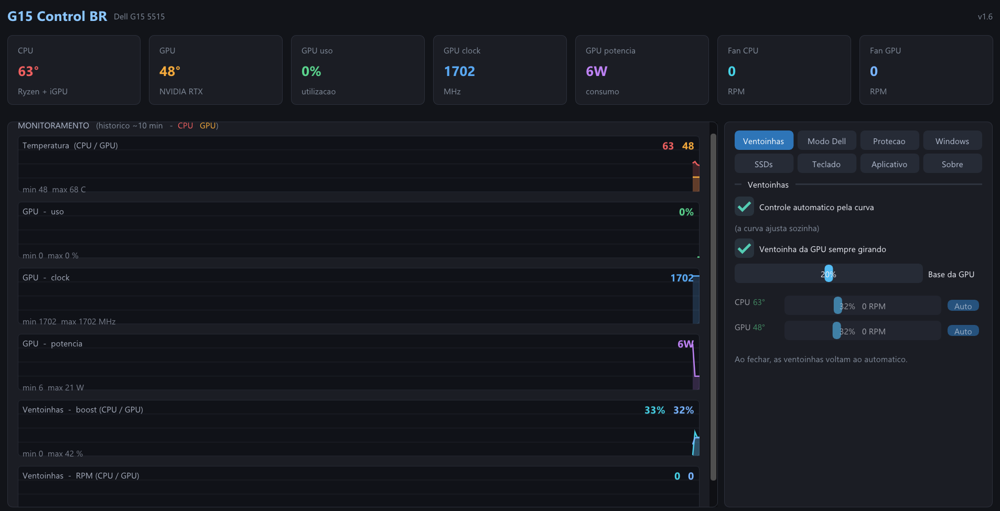
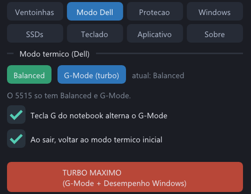
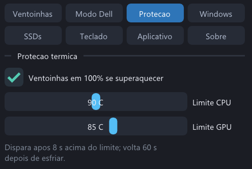
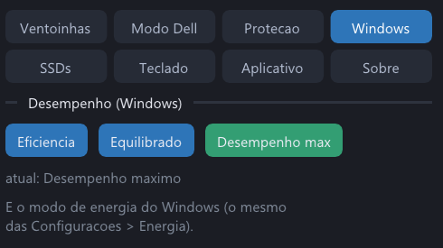
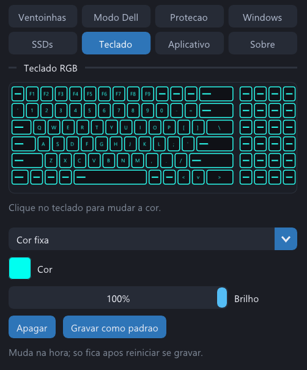

# G15 Control BR

Controlador leve, em C++, para notebooks Dell G-series (desenvolvido e testado no
**Dell G15 5515**, AMD). Alternativa ao AWCC (Alienware Command Center), sem serviços
pesados: ventoinhas, modos térmicos, teclado RGB e monitoramento em um único `.exe`.

> **Projeto não oficial, sem relação com a Dell ou a Alienware.** Mexe em controle térmico
> via BIOS: use com atenção à temperatura, sobretudo nos primeiros testes.

## Capturas de tela

Janela principal: medidores no topo, gráficos de histórico à esquerda e, à direita, os
controles em abas (aqui, **Ventoinhas**: curva automática, base da GPU e boost por ventoinha).

Outras abas:

| Modo Dell | Proteção térmica |
|---|---|
|  |  |
| **Desempenho do Windows** | **Teclado RGB (prévia das 4 zonas)** |
|  |  |

## Download (sem compilar)

**Recomendado:** baixe na página de
[**Releases**](https://github.com/Tarcisio-Soria/G15-Control-BR/releases/latest)
(`g15gui.exe`, `g15ctl.exe` e `SHA256SUMS.txt`). Uma cópia dos mesmos arquivos fica na
pasta [`dist/`](dist/) do repositório:

| Arquivo | O que é |
|---|---|
| [`g15gui.exe`](dist/g15gui.exe) | Interface gráfica (a que você quer usar). Instala-se sozinha se você permitir. |
| [`g15ctl.exe`](dist/g15ctl.exe) | Linha de comando (opcional). |
| [`SHA256SUMS.txt`](dist/SHA256SUMS.txt) | Somas de verificação dos dois arquivos. |

Para conferir o download no PowerShell: `Get-FileHash g15gui.exe` e compare com o `SHA256SUMS.txt`.

**Avisos sobre o executável**

- Ele **não é assinado digitalmente**, então o Windows SmartScreen ou o antivírus podem alertar.
  O código-fonte completo está neste repositório e você pode compilar o seu (veja "Build").
- Ele **pede Administrador**: ler e controlar as ventoinhas pela BIOS exige isso.
- Ao abrir uma cópia não instalada, o app pergunta se deve instalar em
  `%ProgramFiles%\G15 Control BR` ou rodar em modo portátil. Nada é copiado sem você escolher.

## Hardware-alvo

- Testado: **Dell G15 5515** (AMD, ID de modelo `0xc80`, namespace `\_SB.AMW3.WMAX`).
- Em outros G15 (5511/5520/5525/5530/5535/5590) ou Alienware pode funcionar com ajustes,
  mas **só o 5515 foi validado**. Em especial, os IDs das zonas do teclado mudam por modelo.

## O que ele faz

**Interface (`g15gui.exe`, Dear ImGui + DX11)** com gráficos de histórico (atualização a cada 2 s)
e controles em abas:

- **Ventoinhas:** RPM ao vivo, boost por ventoinha (0–255, 0 = automático do firmware),
  **controle automático pela curva** (ligado por padrão), ventoinha da GPU sempre girando
  com **base ajustável** (0–40%).
- **Modo Dell:** Balanceado, G-Mode ou Custom.
- **Proteção térmica:** se CPU ou GPU passar do limite (padrão 95 °C / 85 °C) por 8 s, põe as
  ventoinhas em 100% de boost e devolve o que havia 60 s depois de esfriar.
- **Windows:** modo de energia (Eficiência / Equilibrado / Desempenho).
- **SSDs:** temperatura NVMe via SMART.
- **Teclado:** cor fixa, por zona (4 zonas), respiração e ciclo de cores, brilho, e uma
  prévia do teclado. Pode gravar como padrão de inicialização.
- **Aplicativo:** iniciar com o Windows (tarefa agendada elevada, `--tray`), instalar/desinstalar.
- **Sobre:** versão, autor e links.

Outros recursos: minimizar para a bandeja; **tecla G** do notebook (F17) alterna o G-Mode;
ao sair, as ventoinhas e o modo térmico voltam ao que estavam; as configurações são gravadas
em `%APPDATA%\G15ControlBR\g15gui.ini` pouco depois de cada alteração e ao fechar; só uma
instância roda por vez; um **vigia** reenvia o boost se o firmware passar a ignorá-lo.

**Linha de comando (`g15ctl.exe`):** `status`, `monitor`, `probe`, `rpmtest`, `curve show|run`,
`mode balanced|gmode|custom`, `boost <id-hex>|all <0-255>` e
`kbd info|color|zones|breathe|cycle|bright|off`.

## Como as ventoinhas funcionam neste modelo

Medido no 5515 (detalhes em [`docs/NOTAS-5515.md`](docs/NOTAS-5515.md)):

- O boost é um acréscimo sobre o que o firmware decidiria; o RPM não é definido diretamente.
- Cerca de **100 RPM por 1%** de boost, e o RPM **satura em ~5800/5500** a partir de ~58%.
- O firmware **para a ventoinha da GPU** (0 RPM) quando a placa está fria e o boost é 0;
  por isso existe a opção "sempre girando".
- As ventoinhas mudam ~100 RPM por segundo.

## Build

- Toolchain: MSVC (Build Tools for Visual Studio 2022) + Windows SDK 10.
- Compila no Windows (não no WSL): `powershell -ExecutionPolicy Bypass -File build.ps1`.
- Clone com o submódulo do Dear ImGui: `git clone --recurse-submodules <url>`
  (ou, num clone existente, `git submodule update --init`). A CLI não tem dependências;
  sem o ImGui o script compila só a CLI e avisa.
- Para atualizar os executáveis da pasta `dist/` depois de compilar:
  `powershell -ExecutionPolicy Bypass -File tools/make-dist.ps1`.

## Configuração da curva

A curva (pontos temperatura → boost, intervalo e histerese) usa valores padrão. Para
personalizar, crie `g15ctl.ini` ao lado do `.exe`; `g15ctl curve show` mostra o formato.

## Tecnologias e sistemas usados

| Área | O que é usado |
|---|---|
| Linguagem e build | C++17, **MSVC** (Build Tools for Visual Studio 2022), Windows SDK 10, `rc` para ícone e manifesto |
| Interface | [**Dear ImGui**](https://github.com/ocornut/imgui) (MIT) com backends **Win32** e **DirectX 11**; desenho sob demanda |
| Ventoinhas e modo térmico | **WMI** (`root\WMI`, classe `AWCCWmiMethodFunction`, métodos `Thermal_Information` e `Thermal_Control`), que chama a interface ACPI/WMI da BIOS Dell/Alienware, a mesma do AWCC |
| Teclado RGB | **USB HID** (`hid.dll`, SetupAPI) falando o protocolo **ELC** do controlador `187C:0550`, por relatórios de 34 bytes |
| GPU NVIDIA | [**NVML**](https://developer.nvidia.com/management-library-nvml) (`nvml.dll`, carregada dinamicamente: temperatura, uso, potência e clock) |
| SSDs | **NVMe SMART** via `IOCTL_STORAGE_QUERY_PROPERTY` |
| Energia do Windows | API de *power overlay* (`PowerSetActiveOverlayScheme`) |
| Tecla G | `RegisterHotKey` (a tecla G do notebook chega como F17) |
| Integração com o Windows | Ícone na bandeja, **Agendador de Tarefas** (iniciar com o Windows, elevado), TaskDialog (Common Controls v6), manifesto `requireAdministrator`, entrada em "Aplicativos instalados" |

## Projetos de referência

O protocolo da BIOS e do teclado foi estudado nestes projetos abertos, usados como
documentação do funcionamento (mapa de métodos WMI, IDs de ventoinha e sensor, comandos
do teclado). O código deste repositório foi escrito para este projeto; por termos nos
baseado em projetos GPL, ele também é distribuído sob GPL-3.0:

- [alienfx-tools](https://github.com/t-troll/alienfx-tools) (MIT): suíte Windows de iluminação e
  ventoinhas; fonte dos IDs de zona do teclado.
- [Dell-G-Series-Controller](https://github.com/cemkaya-mpi/Dell-G-Series-Controller) e
  [Dell-G15-Controller](https://github.com/cemkaya-mpi/Dell-G15-Controller) (GPL-3.0): controle de
  teclado e ventoinhas no Linux.
- [tcc-g15 (the0cp)](https://github.com/the0cp/tcc-g15) e
  [tcc-g15 (AlexIII)](https://github.com/AlexIII/tcc-g15) (GPL-3.0): *Thermal Control Center* para G15 no
  Windows; origem da lógica de proteção térmica.
- [Dell_G15_Fan_Cli](https://github.com/Mohit-Pala/Dell_G15_Fan_Cli) e
  [dell-g15-fan-control](https://github.com/vishalrmahajan/dell-g15-fan-control): controle de
  ventoinhas por linha de comando.

Detalhes técnicos e medições no 5515 em [`docs/NOTAS-5515.md`](docs/NOTAS-5515.md).

## Licença

**GPL-3.0** (veja [`LICENSE`](LICENSE)). O Dear ImGui mantém a licença MIT dele.

Autor: Tarcisio Soria — <https://www.linkedin.com/in/kknd/>
